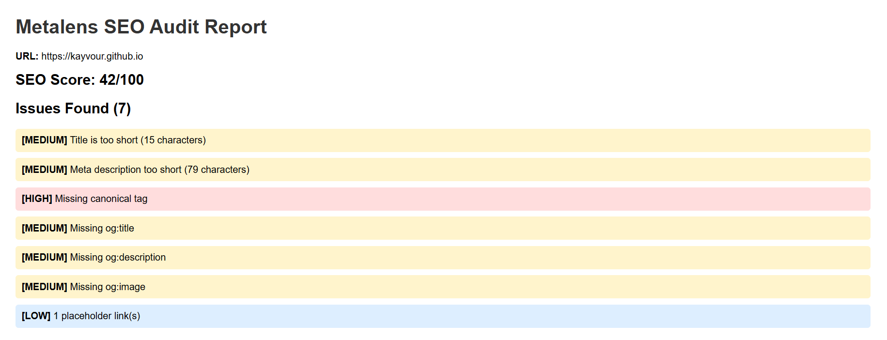

# MetaLens

MetaLens is a simple Python tool for auditing websites and spotting common SEO issues before they become a problem.


## What it does

MetaLens crawls a site, checks key on-page SEO elements, and gives you a score with a list of issues to fix. It can flag things like:

- missing or empty title tags
- missing meta descriptions
- missing H1 tags
- missing canonical tags
- missing Open Graph metadata
- images without alt text
- empty or placeholder links

## Quick start

```bash
git clone https://github.com/kayvour/MetaLens.git
cd MetaLens
pip install -r requirements.txt
python src/main.py
```

## Reports

MetaLens can generate:

- console output for quick checks
- JSON reports for automation
- HTML reports for sharing and review



## Project structure

```text
src/
├── checks/      # SEO checks for titles, meta tags, links, and more
├── crawler/     # Website crawling logic
├── fetcher/     # HTTP fetching layer
├── models/      # Data models for issues and pages
├── parser/      # HTML parsing utilities
├── reporting/   # Report generation
├── scoring/     # SEO score calculation
└── utils/       # Shared helpers and constants
```

## Example output

```text
[MEDIUM] Title is too short (14 characters)
[HIGH] Missing meta description
[HIGH] Missing canonical tag
[MEDIUM] 3 images are missing alt text.
```

## Roadmap

- ✅ Core SEO checks
- ✅ Multi-page crawling and scoring
- ✅ HTML and JSON reporting
- 🔜 A more polished dashboard and deeper comparisons

## License

MIT License
